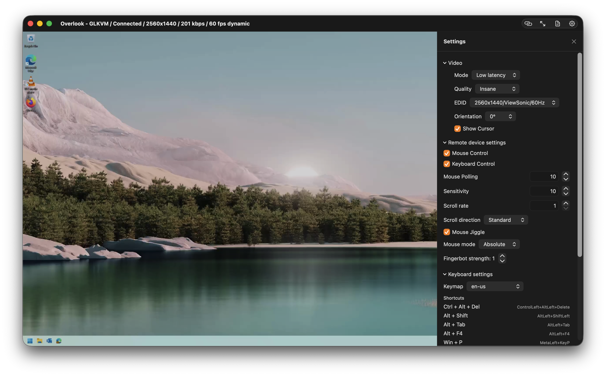
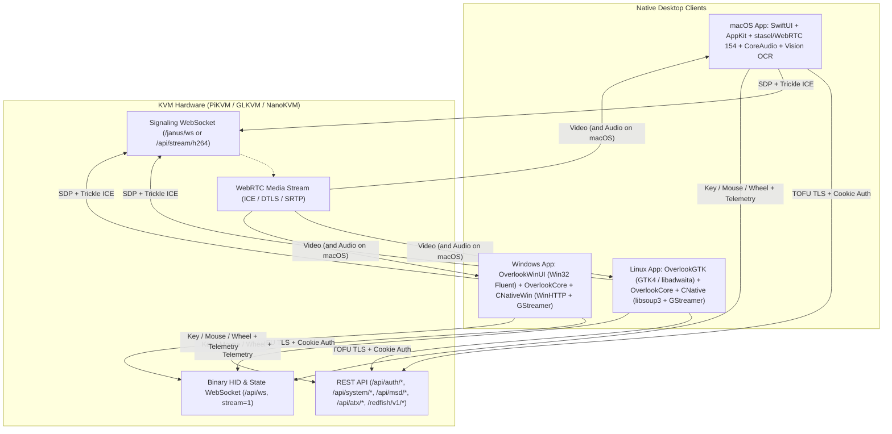

# Overlook

[](https://github.com/alexjsteffen/Overlook/actions/workflows/objective-c-xcode.yml)
[](https://github.com/alexjsteffen/Overlook/actions/workflows/linux.yml)
[](https://github.com/alexjsteffen/Overlook/actions/workflows/windows.yml)

Overlook is a native desktop remote console for **macOS**, **Linux**, and **Windows** supporting **GL.iNet Comet / GLKVM**, **PiKVM (KVMD)**, and **Sipeed NanoKVM (NanoKVM Cube / PCIe / Lite / Full)** hardware.



Built around fast, low-friction “reach over and fix it” workflows—BIOS/UEFI setup, bootloaders, headless servers, and lab benches—Overlook avoids browser wrappers in favor of native WebRTC video streaming, hardware/OS-level keyboard & mouse capture, and direct KVM API integration across every platform:

- **Low-latency native WebRTC video** via Janus (`/janus/ws`) and NanoKVM (`/api/stream/h264`), plus direct **Streamer HTTP Snapshots** (`/api/streamer/snapshot` and NanoKVM `/api/stream/mjpeg`).
- **Full keyboard + mouse input capture** over binary HID WebSockets (`/api/ws`), including physical keycodes, 5-button mouse support, precision scroll accumulation, relative mouse mode (pointer-locked on macOS), live keyboard LEDs, and emulated USB/PS2 output selection.
- **Clipboard & Text Entry bridging**:
  - **Local -> Remote paste** with grapheme-safe 512-scalar chunking (`⇧⌘V` on macOS, `Ctrl+Shift+V` on Linux, **Paste** toolbar button on Windows) via `/api/hid/print?limit=0` or NanoKVM `/api/hid/paste`, cancelling cleanly on disconnect. Plain OS copy/paste (`⌘C`/`⌘V` or `Ctrl+C`/`Ctrl+V`) passes straight through to the remote host.
  - **Remote -> Local OCR**: On macOS, select text directly off live video using on-device **Apple Vision** (`⇧⌘C`) or grab a one-shot snippet (`⇧⌘T` **Copy Text from Area**); across macOS, Linux, and Windows, invoke PiKVM server-side **Tesseract OCR** (`/api/streamer/snapshot?ocr=true`).
- **Network-scoped WebRTC & strict TLS pinning**:
  - **Media Addresses** (`Chosen network only` by default) keeps LAN (`RFC 1918`) and Tailscale (`100.64.0.0/10` / `*.ts.net`) WebRTC traffic on the chosen network without unnecessary public STUN.
  - **TOFU TLS Certificate Pinning** validates `host:port` SHA-256 fingerprints with optional per-session or persistent trust (using a credential-free pre-auth probe on Windows).
  - **macOS multi-window support**: independent console windows (`⌘N`), one-window-per-device deduplication, multi-address `Connect via`, TLS device linking, and active-window vs. all-window audio playback + USB microphone routing.
- **PiKVM, GLKVM & NanoKVM Hardware Management**:
  - **2FA / TOTP Authentication** (6-digit OTP code or RFC 6238 Base32 TOTP secret) and server-side session logout (`/api/auth/logout`).
  - **Video & Streamer**: Quality presets (`Low` / `Medium` / `High` / `Ultra-high` / `Lossless` / `Custom` with automatic 4K EDID GOP halving), 13-preset + custom hex EDID manager, streamer parameters, and automatic detection of unsupported `gl_webrtc` native mode.
  - **Virtual Media (MSD)** (`/api/msd/*` & NanoKVM `/api/storage/media/*`), **ATX Power & Front-Panel Buttons** (`/api/atx/*` & NanoKVM `/api/vm/gpio`), **Redfish BMC Reset** (`/redfish/v1/*`), **User GPIO** (`/api/gpio/*`), **PiKVM Multi-Port Switch** (`/api/switch/*`), **Network Config**, and **System Health / KVMD Logs / Prometheus Metrics**. *(See platform depth differences below.)*

---

## Documentation

| Guide | What It Covers |
| --- | --- |
| [Architecture — How Overlook Works](docs/ARCHITECTURE.md) | End-to-end session flow, WebRTC & GStreamer pipelines, HID capture internals, and module diagrams |
| [PiKVM, GLKVM & NanoKVM API Guide](docs/PIKVM_GLKVM_API_GUIDE.md) | Complete HTTP REST endpoints, Janus & NanoKVM signaling envelopes, and binary HID byte layouts |
| [Platforms, Parity & Shortcuts](docs/PLATFORMS.md) | Detailed macOS / Linux / Windows feature matrix, keyboard shortcuts, and known quirks |
| [Security, Privacy & Storage Paths](docs/SECURITY_AND_STORAGE.md) | TLS TOFU pinning, credential stores, 2FA TOTP rules, `Media Addresses` filtering, entitlements, and disk paths |
| [Building, Packaging & Testing](docs/BUILD_AND_TESTING.md) | Build targets, `OverlookCore` Linux->Windows sync, 930 unit tests, smoke flags, CI workflows, and versions |
| [Linux Port Guide](Linux/README.md) | GTK4 / libadwaita dependencies, native Linux packages, Wayland/AppImage notes, and VA-API recording |
| [Windows Port Guide](Windows/README.md) | Swift + Win32 Fluent shell, bundled GStreamer setup, NSIS installer, and Windows behavior notes |

---

## How Overlook Works

Overlook shares a single protocol and device model across two native UI architectures—no Electron, browser shell, or external Python/FFmpeg requirement is needed to stream video or control input:



1. **Authenticate & Verify Certificate**: Overlook checks the target TLS leaf SHA-256 fingerprint per `host:port` (blocking redirects on login), authenticates via `/api/auth/login` (auto-detecting KVMD/GLKVM form login + 2FA TOTP vs. NanoKVM AES-256-CBC JSON login), and checks `/api/system/get_config` for `gl_webrtc` compatibility.
2. **Scope Media Networking (`MediaRoute`)**: Classifies the peer (`LAN` RFC 1918 vs. `Tailscale`), suppresses public STUN for local/Tailscale hosts, and filters ICE candidates when **Chosen network only** is enabled.
3. **Negotiate Video & Open Binary HID**: Connects WebRTC signaling (`/janus/ws` or `/api/stream/h264`) in parallel with `/api/ws` (`stream=1` so `ustreamer` stays active), optionally sends a **Wake Display on Connect** nudge, and applies non-destructive merged config updates when editing device settings.

See [Architecture — How Overlook Works](docs/ARCHITECTURE.md) for the complete sequence diagram and module walkthrough.

---

## Platform Support at a Glance

| Feature | macOS | Linux (`GTK4 / libadwaita`) | Windows (`Win32 Fluent + GStreamer`) |
| --- | --- | --- | --- |
| **WebRTC Video (Janus & NanoKVM)** | Yes (`stasel/WebRTC`, Metal) | Yes (GStreamer `webrtcbin` + RGBA `GtkPicture`) | Yes (GStreamer `webrtcbin` + D3D11/SW `StretchDIBits`) |
| **Audio Playback & USB Mic** | Yes (dual-peer + CoreAudio HAL) | Not yet (video-only) | Not yet (video-only) |
| **Multi-Window & Menu Bar Icon** | Yes (`⌘N`, 1 window/device) | Single window | Single window (`Ctrl+B` collapsible sidebar) |
| **Device Discovery** | Bonjour (`_comet._tcp`, `_kvm._tcp`) + LAN `/24` sweep + manual | Manual entry + bookmarks | Manual entry + bookmarks |
| **Multi-Address & Device Linking** | Yes (`Connect via` + cert link prompt) | Primary address in UI | Primary address in UI |
| **Keyboard & 5-Button Mouse HID** | Yes + pointer lock (`⌃⌥` unlock) | Yes (shortcut inhibit; no pointer lock) | Yes (`WH_KEYBOARD_LL`; no pointer lock) |
| **Fullscreen Exit Hotkey** | `⌃⌘F` (+ hover HUD) | `Ctrl+Alt+F` anytime / `F11` uncaptured | `Ctrl+Alt+F` anytime / `F11` uncaptured |
| **Chunked Clipboard Paste** | `⇧⌘V` + Remote Text Typing | `Ctrl+Shift+V` + Remote Text Typing | **Paste** toolbar button |
| **OCR** | Apple Vision (`⇧⌘C`, `⇧⌘T`) + Server Tesseract | Server Tesseract | Server Tesseract (read-only dialog) |
| **Screenshots & Recording** | PNG + H.264/HEVC MP4 & AAC M4A | PNG + VA-API / FFmpeg / SW MP4 | PNG + Media Foundation / SW MP4 |
| **Interactive Device Settings** | Full panel (incl. GPIO OUT & Switch ATX) | Interactive 4-page dialog (GPIO read-only; no Switch ATX) | Read-only summary dialogs (use Web Console in browser) |
| **Web Console** | Native UI covers all controls | Embedded WebKitGTK 6.0 (native pkgs; off in AppImage) | Opens default web browser |
| **Credentials & Keyring** | macOS Keychain | `libsecret` keyring | Windows Credential Manager |

See [Platforms, Parity & Shortcuts](docs/PLATFORMS.md) for the complete comparison and quirk list.

---

## Highlights

### 1) Copy from the remote screen (Apple Vision OCR on macOS & Server Tesseract)

- **OCR Selection Mode (`⇧⌘C` on macOS)**: Click a point or drag a box on the live video stream to recognize text with on-device **Apple Vision** in reading order—or PiKVM server **Tesseract OCR** (`GET /api/streamer/snapshot?ocr=true`) when **Prefer Server OCR** is enabled.
- **Copy Text from Area (`⇧⌘T` on macOS)**: One-shot rectangle drag directly to your clipboard with a **Copied N lines** notice.
- **Server OCR button (Linux & Windows)**: Runs `GET /api/streamer/snapshot?ocr=true` and presents recognized text for copying.

### 2) Paste & Type to the remote machine

- **Chunked Remote Paste**: Splits clipboard text along grapheme-cluster boundaries into 512-scalar chunks via `/api/hid/print?limit=0` (or `/api/hid/paste` on NanoKVM), cancelling cleanly on disconnect (`⇧⌘V` on macOS, `Ctrl+Shift+V` on Linux, **Paste** toolbar button on Windows). Plain OS copy/paste (`⌘C`/`⌘V`, `Ctrl+C`/`Ctrl+V`) passes straight to the remote OS.
- **Remote Text Typing & Shortcuts (macOS & Linux)**: Type text with configurable **Slow typing mode** and inter-key delay (`0.00`–`5.00`s) for BIOS/UEFI screens, or trigger `Ctrl+Alt+Del`, `Alt+Tab`, `Alt+F4`, `Meta/Win`, `PrintScreen`, and device shortcuts via `/api/hid/events/send_shortcut`.

### 3) Low-latency WebRTC streaming, Diagnostics & Streamer Snapshots

Collects live WebRTC receiver stats (resolution, FPS, bitrate, jitter, packet loss, PLI/NACK repairs, ICE RTT, active candidate path) alongside live HID RTT and ATX/KB LEDs. Direct JPEG hardware snapshots (`GET /api/streamer/snapshot` or NanoKVM MJPEG frame capture) remain available even when WebRTC is offline.

### 4) Settings Architecture & Non-Destructive Config Writes

- **macOS (`SettingsWindow.swift` + `WebUISettingsPanel.swift`)**: Separates Mac-local preferences (`⌘,`: Appearance, Wake Display, Audio devices & active/all-windows scope, Capture codecs/folders, Input sensitivity, Network scope) from KVM device controls, writing minimal JSON diffs to `/api/system/set_config` so unknown firmware keys (`video_mode`, vendor fields) are never overwritten.
- **Linux (`SettingsDialog*.swift`)**: Provides an interactive 4-page Adwaita preferences dialog covering Video/Capture, EDID, Input/HID, Virtual Media (MSD), ATX/Redfish, Multi-Port Switch, read-only GPIO state, System Health/Logs/Prometheus, and Network configuration, plus an optional WebKitGTK Web Console.
- **Windows (`SettingsDialog*.swift` + `WinUIAdapter.swift`)**: Currently exposes Settings and Connection Information as read-only text summary dialogs while delegating interactive device management to the device Web Console in your default browser.

---

## Keyboard Shortcuts

### macOS

- **In-session (while keyboard capture is active)** — layout-aware, exact modifiers, triggers once per key press:
  - `⇧⌘C`: Toggle OCR Selection Mode.
  - `⇧⌘T`: Copy Text from Area directly to clipboard.
  - `⇧⌘V`: Paste macOS clipboard to remote (512-scalar chunks).
  - `⇧⌘S`: Save screenshot (WebRTC frame or `/api/streamer/snapshot` fallback).
  - `⇧⌘R`: Start or stop recording.
  - `⌃⌘F`: Enter or exit full screen (while captured or via hover HUD).
  - `⌘Q`: Quit Overlook (releases held keys and disconnects first).
  - `⌃⌥` (`Control+Option`): Release captured pointer in relative mouse mode.
- **Menus** (no global hotkeys outside the app): Main menu `⌘N` New Window, `⌘,` Settings…; Menu Bar icon menu `⌘K` Quick Connect, `⇧⌘D` Scan for Devices, `⌘O` Enable OCR.

### Linux (`OverlookGTK`)

- **Anytime (even while keyboard is captured)**:
  - `Ctrl+Alt+F` (Left Alt, so `AltGr+F` still reaches the target): Toggle or exit fullscreen (releases held modifiers & keyboard capture on exit).
- **While captured**: `Left Ctrl + Left Alt` (press & release alone) releases keyboard capture.
- **While uncaptured**: `F11` Fullscreen, `Ctrl+N` New Connection, `Ctrl+R` Reload/Reconnect, `Ctrl+I` Connection Info, `Ctrl+L` Connection Log, `Ctrl+,` Settings, `Ctrl+Shift+S` Screenshot, `Ctrl+Shift+R` Record (VA-API/SW MP4), `Ctrl+Shift+V` Paste to Remote, `Ctrl+W` Disconnect, `Ctrl+Q` Quit.

### Windows (`OverlookWinUI`)

- **Anytime (even while keyboard is captured)**:
  - `Ctrl+Alt+F` (Left Alt, so `AltGr+F` still reaches the target): Toggle or exit fullscreen (releases held modifiers & keyboard capture on exit).
- **While captured**: `Left Ctrl + Left Alt` (press & release alone) releases keyboard capture.
- **While uncaptured**: `F11` Fullscreen, `Ctrl+B` Collapse/expand saved-devices sidebar (persisted across restarts & fullscreen), `Enter` Connect in form, `Tab` / `Shift+Tab` navigate controls. *(Other session actions use the top toolbar buttons.)*

---

## Supported Devices

- **GL.iNet Comet / GLKVM** (`/api/*`, `/janus/ws`, `/api/ws`, MSD/ATX/Network/EDID/Logs/Prometheus)
- **PiKVM (v2, v3, v4, DIY)** running KVMD (`/api/*`, `/janus/ws`, `/api/ws`, GPIO, Multi-Port Switch, Redfish BMC, Server Tesseract OCR)
- **Sipeed NanoKVM (NanoKVM Cube, PCIe, Lite, Full)** (`/api/auth/login` AES-256-CBC auth, `/api/stream/h264` native H.264 WebRTC, `/api/ws` binary USB HID reports, `/api/hid/paste`, `/api/vm/gpio`, `/api/vm/screen`, `/api/vm/mouse-jiggler/`, `/api/storage/media/*`)
- **Any KVMD-compatible device** exposing the PiKVM HTTP/WebSocket API and Janus WebRTC signaling
- **Tailscale peers**: Manually entered or saved `*.ts.net` and `100.64.0.0/10` / `fd7a:115c:a1e0::/48` targets are recognized automatically as Tailscale addresses and use Tailscale-scoped ICE routing (`Chosen network only`). On macOS, **Scan for Devices** currently performs Bonjour (`_comet._tcp`, `_kvm._tcp`) + local LAN `/24` discovery; [Overlook/TailscaleManager.swift](Overlook/TailscaleManager.swift) is in the codebase as a CLI wrapper helper and is not yet wired into automatic discovery.

---

## Installation & Build

The repository-root [Makefile](Makefile) selects the native build for the host OS:

```sh
make
```

- **macOS:** builds `dist/Overlook.app` and `dist/Overlook-macOS.zip`.
- **Linux:** builds the executable `dist/overlook` (`--static-swift-stdlib`).
- **Windows:** invokes `Windows/build.ps1 -Configuration release`.
- Run `make help` to list every target and override.

Build outputs go to `build/` and `dist/`; the checked-in `Overlook.app` is not overwritten. Run `make clean` to remove generated directories.

### macOS

Requirements: macOS 14.0+, Xcode 15+, and network or Tailscale access to your KVM device. A normal local build does **not** require an Apple Developer account:

```sh
make macos
open dist/Overlook.app
```

The normal Makefile build is unsigned for local development. You can also open [Overlook.xcodeproj](Overlook.xcodeproj), select the `Overlook` scheme, and press `⌘R`, or run `./scripts/install-local.sh` to install a Release build in `/Applications`. To keep a stable code-signing identity across rebuilds (preserving Keychain and Microphone grants), copy [Config/Local.xcconfig.example](Config/Local.xcconfig.example) to `Config/Local.xcconfig`.

#### Developer ID signing and notarization

Use a **Developer ID Application** certificate and Apple notarization for a bundle you distribute to other Macs. An Apple Development certificate, an ad-hoc signature, and a Developer ID signature without notarization are not substitutes for a notarized release.

1. **Install the correct certificate.**
   - Join the [Apple Developer Program](https://developer.apple.com/programs/).
   - In Xcode, open **Settings → Accounts**, select your Apple ID and team, then choose **Manage Certificates**.
   - Click **+ → Developer ID Application**. If that option is unavailable, ask the account holder/admin to grant the appropriate access or create the certificate from the [Certificates, Identifiers & Profiles](https://developer.apple.com/account/resources/certificates/list) page.
   - Keep the certificate and its private key in your login keychain. Do not commit either one.

2. **Find your Team ID and confirm the identity.** The Team ID is the 10-character value shown on the [Apple Developer membership page](https://developer.apple.com/account/#!/membership). It is not your Apple ID email address or the full certificate name.

   ```sh
   security find-identity -v -p codesigning
   # The OU value in the certificate subject is also your Team ID:
   security find-certificate -c "Developer ID Application" -p \
     | openssl x509 -noout -subject
   ```

   The first command must list `Developer ID Application`. `make macos-signed` checks this before starting an archive.

3. **Choose a bundle identifier.** Use a reverse-DNS name controlled by you or your organization, such as `com.example.Overlook`. A fork that distributes its own app should use its own identifier. Changing an existing app's identifier causes macOS to treat it as a different app and can reset privacy permissions and keychain access.

4. **Build a Developer ID signed app.**

   ```sh
   make macos-signed \
     APPLE_TEAM_ID=ABCDE12345 \
     MACOS_BUNDLE_ID=com.example.Overlook
   ```

   Replace both example values with your own. The Makefile passes them directly to `xcodebuild`, creates a temporary copy of `ExportOptions.plist` with your Team ID, and leaves both the checked-in plist and Xcode project unchanged. Outputs are:

   - `dist/Overlook.app` — Developer ID signed, with hardened runtime.
   - `dist/Overlook-macOS-signed.zip` — signed but **not yet notarized**.

5. **Create notarization credentials.** In App Store Connect, open **Users and Access → Integrations → App Store Connect API** and create or select a team API key permitted to submit notarizations. Record its **Key ID** and **Issuer ID**, and download its `.p8` private key. The key can normally be downloaded only once. Store it outside the repository and restrict its permissions:

   ```sh
   chmod 600 /path/to/AuthKey_ABCDE12345.p8
   ```

6. **Sign, notarize, and staple the release.**

   ```sh
   make macos-notarized \
     APPLE_TEAM_ID=ABCDE12345 \
     MACOS_BUNDLE_ID=com.example.Overlook \
     APPLE_API_KEY_PATH=/path/to/AuthKey_ABCDE12345.p8 \
     APPLE_API_KEY_ID=ABCDE12345 \
     APPLE_API_ISSUER_ID=00000000-0000-0000-0000-000000000000
   ```

   The `.p8` filename and the API Key ID are separate values from your Apple Team ID. Do not paste private keys, certificate passwords, or notarization credentials into the Makefile.

   `macos-notarized` submits the signed zip with `notarytool`, waits for Apple's result, staples the ticket to the app, verifies the signature and Gatekeeper assessment, and writes the distributable **`dist/Overlook-macOS.zip`**. To repeat the final local checks yourself:

   ```sh
   codesign --verify --strict --deep dist/Overlook.app
   xcrun stapler validate dist/Overlook.app
   spctl --assess --verbose=4 --type execute dist/Overlook.app
   ```

### Linux

A native **Swift + GTK4 + libadwaita** desktop client lives in [Linux/](Linux/README.md). It receives native video via GStreamer `webrtcbin`, transmits binary HID input over `/api/ws`, supports VA-API / software MP4 recording, screenshots, server Tesseract OCR, chunked paste, `libsecret` credential storage, TOFU certificate pinning, an interactive 4-page Adwaita Settings dialog, and an optional ephemeral WebKitGTK 6.0 Web Console. (Audio/microphone, GPIO output toggles, local OCR, and automatic LAN discovery remain unimplemented on Linux.)

Install the GTK, WebKitGTK, GStreamer, and Swift build dependencies listed in the [Linux guide](Linux/README.md#build-and-run), then run:

```sh
make linux
./dist/overlook
make test
```

The Makefile links the Swift runtime into the executable (`--static-swift-stdlib`), so users do not need a separate Swift installation. GTK, libadwaita, WebKitGTK, `libsecret`, and GStreamer runtime libraries/plugins remain system dependencies.

#### Linux packages

Select a format with `PACKAGE`, or use its direct target:

```sh
make package PACKAGE=pacman
make package PACKAGE=deb
make package PACKAGE=rpm
make package PACKAGE=appimage

# Equivalent direct targets:
make pacman
make deb
make rpm
make appimage
```

| Target | Intended build environment and tools | Output in `dist/` |
| --- | --- | --- |
| `pacman` | Arch Linux; `makepkg` | `overlook-VERSION-RELEASE-x86_64.pkg.tar.zst` (or `aarch64`) |
| `deb` | Ubuntu/Debian; `dpkg-deb` and `dpkg-shlibdeps` (`dpkg-dev`) | `overlook_VERSION-RELEASE_amd64.deb` (or `arm64`) |
| `rpm` | Fedora/RPM-based distribution; `rpmbuild` | `overlook-VERSION-RELEASE.x86_64.rpm` (or `aarch64`) |
| `appimage` | Ubuntu 24.04 recommended; `linuxdeploy`, `appimagetool`, `patchelf`, GTK/GStreamer linuxdeploy plugins | `Overlook-VERSION-x86_64.AppImage` (or `aarch64`) |

Build each native package **on its target distribution and architecture**. The default package version is `0.1.1`, with package release `1`:

```sh
make deb VERSION=0.1.2 PACKAGE_RELEASE=1
```

AppImage packaging does not silently download tools. Install `linuxdeploy`, `appimagetool`, the [GTK plugin](https://github.com/linuxdeploy/linuxdeploy-plugin-gtk), and the [GStreamer plugin](https://github.com/linuxdeploy/linuxdeploy-plugin-gstreamer), placing the plugins next to `linuxdeploy` or on `PATH`. On Ubuntu 24.04, the plugins also need these support packages in addition to Overlook's native build dependencies:

```sh
sudo apt-get install dpkg-dev file findutils librsvg2-dev libgirepository1.0-dev patchelf
```

If the AppImage tools are not on `PATH`, pass their paths:

```sh
make appimage \
  LINUXDEPLOY=/path/to/linuxdeploy-x86_64.AppImage \
  APPIMAGETOOL=/path/to/appimagetool-x86_64.AppImage
```

**The AppImage disables the optional Web Console** (`OVERLOOK_DISABLE_WEB_CONSOLE=1`): production WebKitGTK builds embed a non-relocatable helper-process path. Use the DEB, RPM, or Pacman package when Web Console support is required. The AppImage's GTK launcher currently requires X11 or XWayland, whereas native packages support both Wayland and X11.

On Ubuntu 24.04, install `libfuse2t64` to run AppImages directly, or use `--appimage-extract-and-run`:

```sh
./dist/Overlook-0.1.1-x86_64.AppImage --appimage-extract-and-run
```

#### Compile Linux with Docker

The repository-root [Dockerfile](Dockerfile) provides an Ubuntu 24.04 / Swift 6 build without installing build dependencies on the host:

```sh
# Run unit tests and compile in Docker, then export only the executable:
make docker
./dist/overlook

# Build the test image and run its native WebRTC smoke test:
make docker-test
```

### Windows

The Windows port ([Windows/](Windows/README.md)) combines Swift with a native Win32 Fluent shell (`CNativeWin/NativeWin.c`) and an in-process **GStreamer (`webrtcbin`)** WebRTC video and capture engine (`GStreamerWebRTC.c`). It features a custom title bar, collapsible saved-devices sidebar (top-left toggle button or `Ctrl+B`, persisted as `sidebarCollapsed`), fullscreen toggle (`Ctrl+Alt+F` anytime, or `F11` when keyboard capture is inactive), light/dark themes, High Contrast support, Per-Monitor V2 DPI scaling, credential-free `HEAD /` TOFU certificate checks, Windows Credential Manager storage, native chunked paste, PNG screenshots, and Media Foundation MP4 recording. Note that Settings and Connection Info are currently **read-only summary dialogs** on Windows; clicking **Web Console** opens the device's web interface in your default browser.

Install these tools on **64-bit Windows** (Windows 11 recommended):

1. **Visual Studio 2022** (or newer / Build Tools for Visual Studio) with **Desktop development with C++**, **MSVC x64/x86 build tools**, and a **Windows 10/11 SDK** (`rc.exe`, tested with **10.0.26100.0**).
2. **Swift 6 for Windows** (tested with **6.4.2**). Follow the [Swift Scoop setup guide](https://www.swift.org/install/windows/scoop/).
3. **GStreamer 1.0 MSVC x86_64** (**runtime + development** MSIs, tested with **1.26.11**) from [gstreamer.freedesktop.org](https://gstreamer.freedesktop.org/download/).
4. **Git** and **PowerShell 5.1 or newer**.

With [Scoop](https://scoop.sh/) installed:

```powershell
scoop install swift git
```

Reopen PowerShell, clone the repository, and build:

```powershell
git clone https://github.com/alexjsteffen/Overlook.git
cd Overlook
.\Windows\build.ps1 -Configuration release -Test
```

Close any running `Overlook.exe` before rebuilding. The script syncs shared `OverlookCore` sources from `Linux/`, configures Swift/VS/GStreamer paths, compiles `packaging/Overlook.rc` (icon, Per-Monitor V2 DPI manifest, and version info), builds the GUI-subsystem executable, stages required GStreamer plugins and transitive runtime DLLs, and runs the 42 `OverlookCoreTests` unit tests. End users do not need Swift, GStreamer, Python, or FFmpeg installed, and no WinUI 3 / XAML or Windows App SDK dependency is used.

- Executable: `Windows\.build\x86_64-unknown-windows-msvc\release\Overlook.exe`
- Add `-SmokeTest` to run all 5 automated UI/cert/sidebar/WebRTC/capture smoke tests non-interactively.
- Add `-Package` to produce portable `dist\Overlook-Windows-x64.zip`.
- Use `-Configuration debug` for a debug build.

To build a per-user Windows installer, install **NSIS 3** and use [Windows/build-installer.ps1](Windows/build-installer.ps1):

```powershell
scoop bucket add extras
scoop install nsis
.\Windows\build-installer.ps1 -CheckOnly
.\Windows\build-installer.ps1 -Test -Version 1.0.2
```

Installer output: `dist\Overlook-1.0.2-Windows-x64-Setup.exe` (installs to `%LOCALAPPDATA%\Programs\Overlook` with no elevation required, preserves saved devices/preferences/pins/logs/Credential Manager entries on uninstall). See [Windows installer build details](Windows/README.md#build-a-windows-installer) for `-SkipBuild`, `-GStreamerRoot`, and execution-policy options:

```powershell
powershell -NoProfile -ExecutionPolicy Bypass -File .\Windows\build.ps1 -Configuration release -Test
```

---

## Project Structure

- [Makefile](Makefile) — Cross-platform native build orchestration, Linux package formats, Docker builds, and Apple release signing/notarization.
- [Dockerfile](Dockerfile) — Ubuntu 24.04 Linux build, unit test, smoke test, and binary-export stages.
- [docs/](docs/ARCHITECTURE.md) — Detailed technical guides ([ARCHITECTURE.md](docs/ARCHITECTURE.md), [PIKVM_GLKVM_API_GUIDE.md](docs/PIKVM_GLKVM_API_GUIDE.md), [PLATFORMS.md](docs/PLATFORMS.md), [SECURITY_AND_STORAGE.md](docs/SECURITY_AND_STORAGE.md), [BUILD_AND_TESTING.md](docs/BUILD_AND_TESTING.md)).
- [Linux/](Linux/README.md) — Native Linux GTK4/libadwaita client (`OverlookCore`, `CNative`, `CDesktop`, `OverlookGTK`) and `Linux/packaging/`. (`OverlookCore` is canonical here and synced to `Windows/` during Windows builds.)
- [Windows/](Windows/README.md) — Native Windows Win32 Fluent client (`OverlookCore`, `CNativeWin`, `OverlookWinUI`, `Windows/build.ps1`, `Windows/build-installer.ps1`, `Windows/packaging/`).
- [Overlook/OverlookApp.swift](Overlook/OverlookApp.swift), [MenuBarAgent.swift](Overlook/MenuBarAgent.swift), [StatusMenuModel.swift](Overlook/StatusMenuModel.swift) — macOS app entry point, window scenes, graceful shutdown, and menu bar companion.
- [Overlook/ContentView.swift](Overlook/ContentView.swift), [VideoSurfaceView.swift](Overlook/VideoSurfaceView.swift), [DeviceViews.swift](Overlook/DeviceViews.swift) — Main window layout, toolbar, fullscreen HUD, Metal WebRTC surface, and device/edit sheets.
- [Overlook/GLKVMClient.swift](Overlook/GLKVMClient.swift) — Serialized HTTP REST & WebSocket client for GLKVM, PiKVM (Auth + 2FA TOTP, Logout, System Info/Logs, HID, Mouse Jiggler, ATX, MSD, GPIO, Streamer/Snapshots/OCR, Switch, Redfish, Prometheus, `/api/ws`), and Sipeed NanoKVM.
- [Overlook/SessionConnection.swift](Overlook/SessionConnection.swift), [ConsoleSession.swift](Overlook/ConsoleSession.swift), [SessionRegistry.swift](Overlook/SessionRegistry.swift), [ConsoleWindow.swift](Overlook/ConsoleWindow.swift), [WindowDelegateInterposer.swift](Overlook/WindowDelegateInterposer.swift) — Multi-window per-session lifecycle, one-window-per-device invariant, active-window routing, device linking, and `gl_webrtc` detection.
- [Overlook/SettingsWindow.swift](Overlook/SettingsWindow.swift), [WebUISettingsPanel.swift](Overlook/WebUISettingsPanel.swift), [WebUISettingsPanelModel.swift](Overlook/WebUISettingsPanelModel.swift), [WebUISettingsActions.swift](Overlook/WebUISettingsActions.swift), [WebUISettingsSections.swift](Overlook/WebUISettingsSections.swift) — macOS Preferences (`⌘,`) + non-destructive merged KVM hardware settings panel.
- [Overlook/MediaNetwork.swift](Overlook/MediaNetwork.swift), [JanusSignaling.swift](Overlook/JanusSignaling.swift), [RemotePaste.swift](Overlook/RemotePaste.swift), [ScrollAccumulator.swift](Overlook/ScrollAccumulator.swift), [QualityPreset.swift](Overlook/QualityPreset.swift), [ShortcutKeyLayout.swift](Overlook/ShortcutKeyLayout.swift) — Network-scoped WebRTC routing, serialized Janus signaling & sender filtering, grapheme-safe paste, scroll accumulation, Lossless + 4K GOP presets, and layout-aware chords.
- [Overlook/InputManager.swift](Overlook/InputManager.swift), [InputFocusGate.swift](Overlook/InputFocusGate.swift) — Keyboard/mouse capture, ISO/JIS/F1–F20/Help key mapping, relative pointer lock, and serialized `/api/ws` HID transport.
- [Overlook/OCRManager.swift](Overlook/OCRManager.swift), [OCRSnippet.swift](Overlook/OCRSnippet.swift), [OCRViews.swift](Overlook/OCRViews.swift) — Apple Vision OCR (reading order + one-shot area snippet) and PiKVM Server Tesseract OCR pipeline.
- [Overlook/KVMDeviceManager.swift](Overlook/KVMDeviceManager.swift), [DiscoveryRules.swift](Overlook/DiscoveryRules.swift), [TailscaleManager.swift](Overlook/TailscaleManager.swift) — Bonjour (`_comet._tcp`, `_kvm._tcp`), RFC 1918 `/24` sweep & HTTP fingerprinting (`TailscaleManager.swift` provides CLI bindings, not yet wired into discovery).
- [Overlook/MediaCaptureHub.swift](Overlook/MediaCaptureHub.swift), [SessionRecorder.swift](Overlook/SessionRecorder.swift), [CaptureManager.swift](Overlook/CaptureManager.swift), [CaptureViews.swift](Overlook/CaptureViews.swift) — PNG screenshots, streamer snapshots, and MP4/M4A session recording.
- [Overlook/DeviceTrustStore.swift](Overlook/DeviceTrustStore.swift), [KeychainTokenStore.swift](Overlook/KeychainTokenStore.swift), [DevicePasswordStore.swift](Overlook/DevicePasswordStore.swift) — TOFU certificate pinning and macOS Keychain storage.
- [OverlookTests/](OverlookTests/) & [Linux/Tests/OverlookCoreTests/](Linux/Tests/OverlookCoreTests/) — 888 macOS Swift Testing tests and 42 cross-platform `OverlookCore` XCTest cases.

---

## License

This project is licensed under the **GNU General Public License v3.0**. See [`LICENSE.MD`](./LICENSE.MD).
