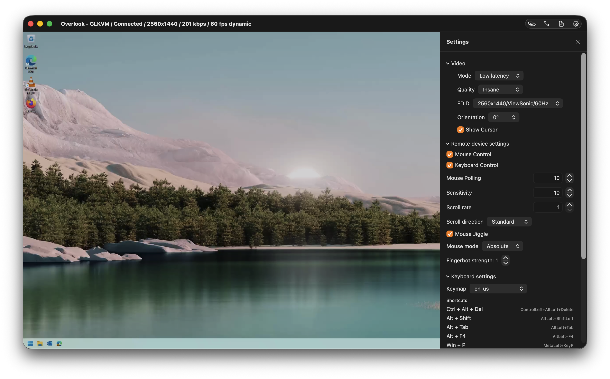

# Overlook

Overlook is a macOS-native remote console for GL.iNet GLKVM / Comet-style KVM devices.

It focuses on *fast*, *low-friction* day-to-day “reach over and fix it” workflows:

- Low-latency WebRTC video streaming (Janus signaling).
- Full keyboard + mouse input capture.
- **Clipboard bridging**:
  - **Local → Remote paste** with `⌘V` (types the clipboard into the remote machine).
  - **Remote → Local copy via ML OCR**: select text directly from the live video stream using Apple Vision and copy it to your Mac clipboard.

If you spend time in BIOS/UEFI, bootloaders, headless servers, or “the machine that’s *just* out of reach”, Overlook aims to make the remote console feel like a first-class Mac app.

---

## Highlights

### 1) Copy from the remote screen using ML OCR

Overlook includes an **OCR Selection Mode** that behaves like “Live Text” for a remote computer:

- Turn on OCR mode.
- Drag a box on the video stream.
- Overlook runs on-device OCR (Apple Vision framework), shows the recognized text, and you can copy it to your clipboard.

This is especially useful for:

- Capturing one-time passwords, serial numbers, IPs, MAC addresses.
- Copying terminal output from machines with no clipboard integration.
- Copying text in pre-boot environments.

**Note:** OCR is performed locally on your Mac.

### 2) Paste to the remote machine with `⌘V`

Overlook intercepts `⌘V` while input capture is enabled and sends the macOS clipboard to the remote via the device’s HID “print text” API.

This replaces the old “Paste to Remote” settings UI: the workflow is now the shortcut you already expect.

### 3) Low-latency WebRTC video

Overlook uses WebRTC for streaming and collects receiver stats (bitrate, fps, jitter buffer / playout delay, decode time, packet loss, ICE RTT).

These stats are surfaced in the window title, which makes diagnosing latency issues and tuning quality settings much easier.

### 4) A focused Settings panel (WebUI-aligned)

The Settings UI is intentionally aligned with GLKVM’s WebUI behavior where it matters:

- **Video quality presets** (Low/Medium/High/Ultra-high/Insane/Custom).
- **EDID** selection and custom EDID entry.
- Audio + microphone toggles (reconnect required).

## Additions / Changes / Improvements over upstream

### 5) Screenshots and recordings

- **Screenshot** (camera button, `⇧⌘S`): saves the frame on screen as a PNG at the stream's native resolution.
- **Record** (record button, `⇧⌘R`): saves the received stream as it plays. The button's menu picks what is kept — **Video and Audio** or **Video Only** (`.mp4`, H.264 by default or HEVC) or **Audio Only** (`.m4a`, AAC).
- Files land in `~/Pictures/Overlook` and `~/Movies/Overlook` under timestamped names (folders and codec are in Settings → Capture); a toast with **Show** appears after each save.
- **Capture region** (dashed-rectangle button): Drag a rectangle on the screen to only capture a portion of the window in screenshots and recordings. The region lasts until you turn it off or quit Overlook.

### 6) Diagnostic logs

- **Log Panel**: View low level details to help troubleshoot connectivity issues.

### 7) Numerous bug fixes / improvements

#### Security

- **Certificate trust**: every device connection (HTTP API, HID WebSocket, Janus signaling) accepted any TLS certificate.
- **Token storage**: device auth tokens — full keyboard and mouse control — were kept in UserDefaults, readable by any process running as the user.
- **Auth errors**: any connection failure (timeout, refusal, 5xx) was reported as "Authentication failed" and prompted for a password; a wrong password surfaced as a generic connection error.
- **Password retention**: typed passwords stayed in view state after a connect sheet closed, and reappeared in the field next time.
- **Tailscale install**: installTailscale() downloaded a binary over the network, chmod +x'd it in a temp directory and ran it.
- **Global key monitor**: the menu bar agent's global keyDown monitor was never stored or removed, so it received every keystroke system-wide for the life of the process.
- **libwebrtc**: pinned to an early-2023 M109 build with memory-safety fixes outstanding.

#### Signaling and connection

- **Keepalive timer mode**: Janus keepalives ran on .default, so an open menu, a window drag, or a scroll tracking loop stopped them long enough for the server to reap the session.
- **Keepalive failures**: send errors were swallowed ("next user action will reconnect"), so a dead session just sat there.
- **Janus notifications**: hangup, timeout, media, slowlink and error were dropped by an early janusType != "event" bail, so a server-side disconnect never carried a reason.
- **App Nap**: no activity assertion, so occluding the window widened every timer's coalescing window — including the keepalive's.
- **Sleep/wake**: sockets don't survive sleep and nothing noticed until a read failed, which a black-holed path can delay for minutes.
- **Network path changes**: a Wi-Fi/Ethernet switch or a Tailscale direct↔DERP transition looked like an unexplained drop.
- **STUN**: a public STUN server was queried even for LAN, link-local and Tailscale peers, adding a round trip to every connect and stalling where UDP/3478 is filtered outbound.
- **Janus transactions**: waitForJanusTransaction waited forever when the device never answered.
- **Stale listeners**: a signaling listener belonging to a torn-down socket could act on its successor's state.
- **URLSession leak**: the signaling session retains itself until invalidated and was leaked on every connect.
- **Superseded connects**: an attempt superseded by a newer connect tore down its successor from its own error path.

#### Input and HID

- **Relative mode**: the vertical delta was inverted.
- **Sub-pixel deltas**: fractional movement was rounded away, so slow movement never moved the remote cursor.
- **Cursor capture**: the local cursor was never captured in relative mode, so deltas stopped at the screen edge.
- **Mouse mode sync**: the mode was read once on connect from the WebUI config — a stored preference, not the gadget's live mode — and the toggle only wrote that config back; kvmd silently drops relative reports sent to a gadget in absolute mode.
- **Device event stream**: an unbounded buffer that was never drained.
- **HID ordering**: each key and mouse event was sent in its own task, so they raced and reached the device out of order.
- **HID socket recovery**: a dropped socket stayed dropped until the device was reconnected by hand.
- **Stuck keys**: keys and buttons held when the socket closed stayed held on the target.
- **Device switching**: switching devices from the menu bar kept a live HID socket open to the previous device.
- **Quit**: quitting with a key or button held left it held on the target, and the video session lingered on the device until its keepalive expired.
- **⌘Q**: reached the target as Meta+Q while input was captured, leaving no keyboard way to quit.

#### Audio

- **Microphone entitlement**: the hardened-runtime build carried no audio-input entitlement, so a Release build could never be granted the microphone.
- **Mic without audio**: the device only carries the mic on its audio session, so Microphone with Audio off negotiated a session with no audio m-line and the mic went nowhere.
- **Stereo**: the SDP answer omitted stereo=1, so the device's stereo audio was decoded as mono.
- **CoreAudio sample rate**: a chosen input/output was asked for 48 kHz regardless of its nominal rate, so a 44.1 kHz DAC or a 16 kHz Bluetooth headset failed to initialize.
- **CoreAudio playback**: the custom device played mono.
- **CoreAudio capture buffer**: the capture buffer was reused with a byte size that shrank to the first callback's frame count.
- **Audio toggles**: Audio and Microphone reset to off at every launch while the device choices persisted.
- **Handle collision**: video offered on the audio handle was also rendered, so the two sessions fought over the view.

#### Telemetry and UI

- **Latency**: the Connections panel pinged over a WebRTC data channel nothing on the device answers, so it read 0 forever.
- **ICE RTT**: the selected candidate pair was found by a selected flag libwebrtc never sets, so ICE RTT was a
- **Stats re-render**: ~15 scalar stats published several times per second re-evaluated the whole view hierarchy and leaked SwiftUI observation state — 101% CPU, footprint climbing past 450 MB.
- **Status menu**: items auto-enabled, so Disconnect's isEnabled never took effect; the connection sink also r step stale.
- **Connect sheets**: Return did nothing in the Manual Connect and Password sheets.
- **Release builds**: hardened-runtime library validation rejected the vendor-signed WebRTC.framework, so any m ID died at launch with a dyld Team ID mismatch.
- **Scan cancellation**: a scan could not be cancelled, and results from an abandoned scan still landed in the device list.
- **Scan probes**: 64 concurrent probes tripped router rate limiting and starved the mDNS browsers; each dead P timeouts.

---

## What devices are supported?

Overlook is built around GL.iNet’s GLKVM/Comet HTTP + WebRTC stack.

In code, devices are modeled as `KVMDevice` and discovered/managed by `KVMDeviceManager`.

If you have:

- GL.iNet Comet / GLKVM
- A GLKVM-compatible device exposing Janus signaling at `wss://<host>:<port>/janus/ws`

…Overlook is intended to work.

For now, it's only designed for local network use or direct IP connections (e.g. over VPN).

---

## Installation

### Requirements

- macOS 14+ (deployment target in project is macOS 14.0).
- Xcode (use the repository’s `Overlook.xcodeproj`).
- Network access to your KVM device.

### WebRTC dependency

Overlook uses the Swift Package:

- `https://github.com/stasel/WebRTC` (pinned in `Package.resolved`)

### Build

1. Open `Overlook.xcodeproj` in Xcode.
2. Select the `Overlook` scheme.
3. Build + Run.

### Release builds and code signing

The embedded `WebRTC.framework` carries its publisher's code signature. The app is built with the
hardened runtime, whose library validation only accepts frameworks signed with the app's own
Team ID — so an archive signed without one (Xcode's "Sign to Run Locally" / ad-hoc, which is what
`DEVELOPMENT_TEAM = ""` gives you) used to die at launch with a dyld error ("mapping process and
mapped file (non-platform) have different Team IDs"). Xcode disables the hardened runtime for
ad-hoc *Debug* runs, which is why Build + Run never showed it.

`Overlook.entitlements` therefore carries `com.apple.security.cs.disable-library-validation`.
With a real Team ID (Developer ID export, as in `.github/workflows/release.yml`) Xcode re-signs the
framework and the exception is not needed, but it does no harm and notarization accepts it.

### Install a build in /Applications

`scripts/install-local.sh` builds the Release configuration, verifies the signature, quits any
running copy, and installs the app as `/Applications/Overlook.app` (pass another folder as the
first argument, e.g. `~/Applications`). The Xcode equivalent is Product → Archive, then
Distribute App → Custom → Copy App, and dragging the exported `Overlook.app` into Applications.

An ad-hoc signature changes with every build, so after each install the login keychain asks once
whether Overlook may read its saved device tokens and passwords — choose Always Allow. Setting a
Team under Signing & Capabilities gives the app a stable identity and ends the prompts.

---

## Quick Start (How to use Overlook)

### 1) Discover or add a device

Overlook supports multiple discovery methods (mDNS + network scanning + common target probes) and also manual entry.

From the main window:

- Click **Scan** to search your network.
- Or click **Manual Connect…** to enter host/IP and port.

From the menu bar:

- Use the Overlook status item to scan and connect quickly.

### 2) Connect

Select a device, then connect.

On connect, Overlook will:

- Authenticate to the device API (cookie token).
- Enable HID on the device.
- Start WebRTC streaming.
- Start keyboard/mouse capture.

If authentication fails, you’ll be prompted for a password and Overlook will attempt a login.

### 3) Control the remote machine

Once connected:

- Mouse movement, clicks, dragging, and scroll are forwarded.
- Keyboard is captured and forwarded.
- Standard UX flows like fullscreen work well for “monitor replacement” usage.

---

## OCR Copy Mode (Remote → Local)

### Enable OCR mode

You can enable OCR mode from:

- The main toolbar button (document/text icon).
- The fullscreen hover controls.
- The menu bar item (also supports a global shortcut).

When OCR mode is enabled:

- Overlook captures video frames from the WebRTC stream.
- It periodically detects text regions and overlays bounding boxes.

### Select text

OCR selection supports two gestures:

- **Click:** OCR a small region around the click point.
- **Drag a rectangle:** OCR the selected region.

Overlook then shows a “Recognized Text” sheet where you can:

- Copy the recognized text to your macOS clipboard.
- Close the sheet.

### Notes / limitations

- OCR accuracy depends on resolution, compression, font size, and contrast.
- OCR is currently tuned for English but uses automatic language detection.
- OCR works even when the remote machine has no clipboard support.

---

## Clipboard Paste (Local → Remote)

### Paste with `⌘V`

When connected and input capture is active:

- Press `⌘V` on your Mac.
- Overlook reads your macOS clipboard and sends it to the remote machine via the device’s HID text entry API.

This is ideal for:

- Commands
- URLs
- Password manager output (use responsibly)
- Small scripts / config snippets

### Tips

- If you paste a very large block of text, the remote side may take time to process.
- For best reliability, paste smaller chunks when interacting with BIOS/UEFI or slow boot environments.

---

## Keyboard shortcuts

Overlook includes a few “quality of life” shortcuts.

### In-session shortcuts (while keyboard capture is enabled)

- `⌘C`: toggles OCR selection mode (so you can “copy” from the remote screen).
- `⌘V`: pastes macOS clipboard to the remote.
- `⇧⌘S`: saves a screenshot.
- `⇧⌘R`: starts or stops a recording.
- `⌘Q`: quits Overlook (releases any held keys and hangs up first).

All five are intercepted before they reach the target, so the target never receives them — on a Windows target that means Win+Shift+S (Snipping Tool), Win+Shift+R and Win+Q are not reachable through Overlook. `⇧⌘S` and `⇧⌘R` are also the **Capture** menu's shortcuts, so they work when keyboard capture is off as well.

### Menu bar global shortcuts

The menu bar agent listens for global shortcuts using `⌘⇧` modifiers:

- `⌘⇧O`: Toggle OCR.
- `⌘⇧D`: Scan for devices.
- `⌘⇧V`: Open Quick Connect.

(These are intended as fast, “from anywhere” actions.)

---

## Settings

Overlook’s settings UI lives in `Overlook/WebUISettingsPanel.swift` and is designed to map closely to the GLKVM WebUI.

### Video

- **Mode**: video processing mode (low-latency oriented).
- **Quality Presets**:
  - Low: `h264_bitrate=500`, `h264_gop=30`, `stream_quality=0`
  - Medium: `h264_bitrate=2000`, `h264_gop=30`, `stream_quality=1`
  - High: `h264_bitrate=5000`, `h264_gop=60`, `stream_quality=2`
  - Ultra-high: `h264_bitrate=8000`, `h264_gop=60`, `stream_quality=3`
  - Insane: `quality=100`, `h264_bitrate=20000`, `h264_gop=60`, `stream_quality=3`
  - Custom: unlocks the advanced streamer controls

- **EDID**:
  - Pick from known-good EDID presets.
  - Or choose “Custom” and paste your own EDID blob.

### Audio

- Audio output toggle.
- Microphone toggle.

**Important:** the UI indicates reconnect is required for audio/mic changes.

Playback and capture always go through Overlook's own CoreAudio device (`WebRTCAudioDevice`), bound to the chosen devices or, with **System Default**, to the defaults at connect time. A default that changes mid-session (headphones plugged in) is followed with an automatic reconnect.

### Capture

- **Screenshots** / **Recordings** folders: where files are saved (`~/Pictures/Overlook`, `~/Movies/Overlook` by default). Click the path to open it.
- **Video codec**: H.264 (plays everywhere) or HEVC (smaller files). Applies to the next recording; audio is always AAC.
- What a recording keeps is chosen from the record button's menu (or Capture → Record): video and audio, video only, or audio only. A recording asked to include audio while Audio is off falls back to video only and says so.
- **Capture region**: the current region's size in guest pixels with **Clear**, or **Select…** to draw one; **Outline the region on the video** hides or shows the dashed outline. The region is kept as a fraction of the guest screen, so a guest that changes resolution keeps the same portion; crops are snapped to even pixel edges and are at least 16 × 16.

### Mouse

The device's **Mouse mode** (Absolute / Relative) is read from the KVM on connect, whenever input capture resumes, and when the device reports a HID state change. The active mode is shown at the end of the window title.

- **Absolute** (default): the remote cursor follows your local cursor's position over the video. This only works when the KVM's HDMI input is the target's *only* display — with an extended desktop, absolute coordinates span every display and the cursor lands off-screen.
- **Relative**: works like a VM console. **Click the video to capture the pointer** — the local cursor is hidden and frozen while movement, clicks and scrolling go to the remote. **Press ⌃⌥ (Control+Option) to release.** The pointer is also released when the window loses focus or an overlay opens.
  - **Local sensitivity** (Settings → Remote device settings) scales movement before it is sent. At 1.00× the remote cursor travels the same on-screen distance your local cursor would have, regardless of window size.
  - **Unaccelerated input (experimental)** sends raw pointer counts instead of macOS-accelerated movement, which avoids double acceleration when the target OS also accelerates the mouse. Turn off "Enhance pointer precision" (Windows) on the target for the most predictable result.

---

## Troubleshooting

### “I can’t find my device when scanning”

- Make sure your Mac is on the same network as the KVM.
- Try **Manual Connect…** with the host/IP and port.
- Some networks block mDNS; Overlook also does a best-effort port scan and probes common targets.

### “WebRTC connects but video is blank / unstable”

- Confirm the device’s WebUI works.
- Try toggling reconnect.
- Check the window title stats (bitrate/fps) to confirm frames are arriving.

### “OCR doesn’t detect text”

- Increase stream quality (higher bitrate helps OCR).
- Make the text larger on the remote side.
- Avoid heavy compression artifacts (try High/Ultra-high/Insane).

### “In relative mode the cursor drifts, stalls, or moves the wrong way”

- Check the window title says **Mouse: Relative**. If it says Absolute, Overlook has not picked up the device setting yet — open Settings once, or disconnect and reconnect.
- Click the video to capture the pointer; movement is only forwarded while captured.
- Disable pointer acceleration on the target (Windows: “Enhance pointer precision”), then tune **Local sensitivity**.

### “Paste doesn’t work”

- Ensure you’re connected.
- Ensure input capture is active.
- Confirm the remote cursor focuses a text field.

---

## Development notes

### Project structure

- `Overlook/ContentView.swift`
  - Main app UI and fullscreen experience.
- `Overlook/VideoSurfaceView.swift`
  - Hosts the WebRTC video view.
  - Routes mouse/scroll events.
  - Implements OCR selection gestures.
- `Overlook/WebRTCManager.swift`
  - WebRTC peer connection + Janus signaling.
  - Receiver stats collection.
  - Optional audio/mic track.
- `Overlook/InputManager.swift`
  - Keyboard/mouse capture.
  - Local→remote paste (`⌘V`).
  - HID transport via WebSocket to the device.
- `Overlook/OCRManager.swift` + `Overlook/OCRViews.swift`
  - Apple Vision OCR pipeline.
  - Text region overlay + “Recognized Text” sheet.
- `Overlook/GLKVMClient.swift`
  - Device HTTP APIs (streamer params, system config, EDID, HID print, etc.).
- `Overlook/KVMDeviceManager.swift`
  - Discovery, saved devices, authentication.
- `Overlook/MenuBarAgent.swift`
  - Menu bar UI + quick actions.
- `Overlook/MediaCaptureHub.swift`, `Overlook/SessionRecorder.swift`, `Overlook/CaptureManager.swift`, `Overlook/CaptureViews.swift`
  - Screenshots and recordings. `MediaCaptureHub` is where decoded frames (`WebRTCManager.renderFrame`) and playout PCM (`WebRTCAudioDevice`) are handed over, and holds `CaptureRegionGeometry` / `FrameCropper` (region → even-aligned pixel rect; per-frame NV12/BGRA plane copy into a pooled buffer); `SessionRecorder` muxes them with `AVAssetWriter`, cropping to the region it was started with; `CaptureManager` owns the UI state (including the session-only capture region), folders and file names; `CaptureViews` has the toolbar controls, the region selection overlay and outline, the Capture menu and the settings section. The drag itself lives in `VideoSurfaceView`, next to the OCR drag.

### Security notes

- Device certificates are pinned on first use, like SSH host keys: the first certificate a device presents is recorded, and later connections must match it. If it changes (for example after a factory reset) Overlook refuses to connect until you accept the new certificate from the prompt or **Forget** the device. Certificates that pass normal system trust are accepted without pinning. Ports 80/8080 use plain HTTP and are not protected.
- Device auth tokens are stored in your login keychain (one item per device, service `com.rcawston.Overlook.kvm-auth-token`), not in preferences; tokens saved by earlier versions are moved there on first launch. Treat them like passwords. Ad-hoc signed development builds may prompt for keychain access after a rebuild — choose Always Allow.
- **Save password for this device** (offered wherever a password is entered) keeps the password in the keychain too (service `com.rcawston.Overlook.kvm-password`) and uses it to log back in when the device's token expires. A saved password the device rejects is deleted so you are prompted again. Forgetting a device removes its token, password and pinned certificate.

---

## License

This project is licensed under the **GNU General Public License v3.0**.

See [`LICENSE.md`](./LICENSE.MD).
