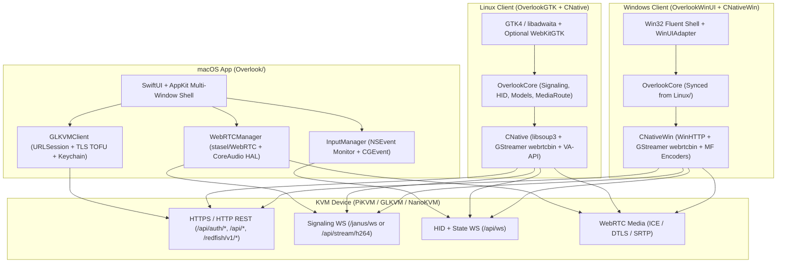
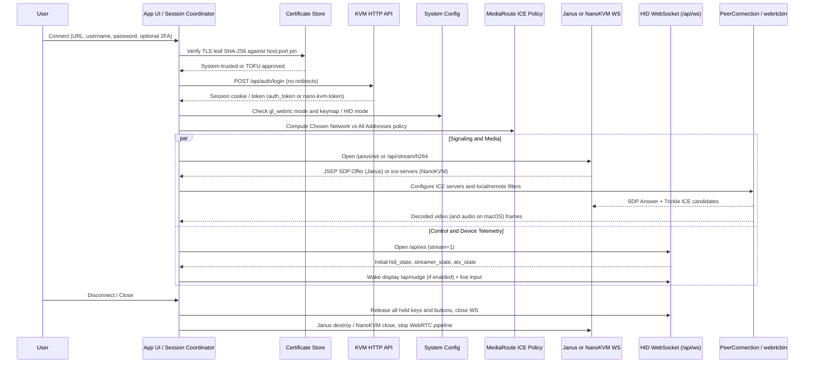
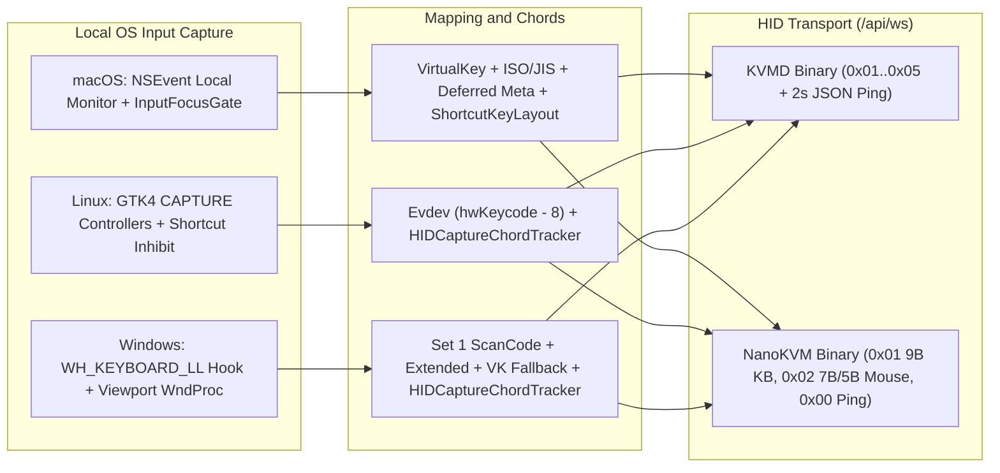

# Overlook Architecture — How the App Works

Overlook is a multi-platform native desktop KVM-over-IP console for **GL.iNet Comet / GLKVM**, **PiKVM (KVMD)**, and **Sipeed NanoKVM (Cube / PCIe / Lite / Full)** hardware. Rather than embedding Electron or wrapping a full browser session for day-to-day control, Overlook talks directly to each KVM device's authentication, HTTP REST, Janus/NanoKVM WebRTC signaling, ICE/DTLS/SRTP media, and binary HID WebSocket APIs.

---

## 1. Repository & Codebase Topology

The repository houses two distinct native implementation stacks sharing one protocol model:

1. **macOS Native Application ([Overlook/](../Overlook/) and [OverlookTests/](../OverlookTests/))**:
   - Built with **SwiftUI + AppKit**, [stasel/WebRTC](https://github.com/stasel/WebRTC) (`154.0.0`), Metal video rendering (`RTCMTLNSVideoView`), a custom HAL CoreAudio device (`WebRTCAudioDevice`), Apple Vision OCR (`VNRecognizeTextRequest`), and `AVAssetWriter` session recording.
   - Managed through [Overlook.xcodeproj](../Overlook.xcodeproj/project.pbxproj) with `MACOSX_DEPLOYMENT_TARGET = 14.0`.
2. **Cross-Platform Shared Core (`OverlookCore`) + Native Desktop Shells**:
   - **Shared Core ([Linux/Sources/OverlookCore/](../Linux/Sources/OverlookCore/))**: 12 pure-Swift files implementing `Device`, `CertificateStore`, `JanusSignaling`, `NanoKVM`, `HIDInput`, `KVMModels`, `MediaNetwork`, `RemotePaste`, `CaptureConfig`, `EDIDCatalog`, `StreamTelemetry`, and `ConnectionLog`. `Linux/` is the canonical copy; [Windows/build.ps1](../Windows/build.ps1) copies these `.swift` files verbatim into `Windows/Sources/OverlookCore/` before building.
   - **Linux Client ([Linux/Sources/OverlookGTK/](../Linux/Sources/OverlookGTK/) + [Linux/Sources/CNative/](../Linux/Sources/CNative/))**: GTK4 + libadwaita UI bridged through thin C shims ([Linux/Sources/CDesktop/](../Linux/Sources/CDesktop/)), `libsoup3` HTTP/WebSockets, GStreamer `webrtcbin` video decoding (`GdkMemoryTexture` -> `GtkPicture`), VA-API/GStreamer/FFmpeg MP4 recording, `libsecret` keyring storage, and an optional ephemeral WebKitGTK 6.0 Web Console.
   - **Windows Client ([Windows/Sources/OverlookWinUI/](../Windows/Sources/OverlookWinUI/) + [Windows/Sources/CNativeWin/](../Windows/Sources/CNativeWin/))**: Native Win32 shell styled around Windows 11 Fluent conventions paired with an in-process GStreamer `webrtcbin` engine (`GStreamerWebRTC.c`), WinHTTP HTTP/WebSockets, Windows Credential Manager, D3D11/software frame decode (`StretchDIBits`), and Media Foundation (`mfh264enc`/`mfh265enc`) MP4 recording. The `OverlookWinUI` target name is historical; no WinUI 3, XAML, or `swift-winui` runtime is used. (`WinUIAdapter.swift` maps the GTK-shaped Swift dialog/window calls onto the native Win32 shell in `NativeWin.c`.)

---

## 2. End-to-End Connection & Session Lifecycle

Every native connection follows the same conceptual pipeline regardless of operating system:

### Step-by-Step Connect Flow

1. **Address Parsing & Scheme Defaults** (`DeviceAddress.parse` in `OverlookCore/Device.swift`; `AddressInput.parse` in `Overlook/DeviceIdentity.swift`):
   - Trims whitespace and rejects credentials-in-URL (`user@`), query parameters, fragments, or non-HTTP(S) schemes.
   - Explicit `http://` stays HTTP (default port `80`). Bare addresses or explicit ports `80`/`8080` resolve appropriately (on Linux and Windows, bare ports `80` and `8080` select `http`; implicit HTTPS attempts can also fall back to HTTP when no explicit port was given and TLS fails).
2. **TLS Verification & TOFU Pinning**:
   - **macOS (`DeviceTrustSessionDelegate`)**: evaluates `SecTrustEvaluateWithError`; system-trusted certs proceed, unseen self-signed leaf certs are auto-pinned (SHA-256 of leaf DER) by `host:port`, and a changed pin cancels the challenge and prompts the user (`Trust New Certificate`).
   - **Linux (`Native.c`) & Windows (`NativeWin.c`)**: never bypass TLS globally. Linux inspects TLS failure flags inside `libsoup3`'s `accept-certificate` signal; Windows executes a **credential-free, cookie-free `HEAD /` probe** (`probe_untrusted_certificate`) before any login payload is transmitted, hashes the leaf certificate with `BCryptHash`, and asks **Cancel** / **Trust Once** / **Always Trust** (or **Replace and Trust** when an existing pin changes).
3. **Authentication & Backend Detection**:
   - Requests never follow HTTP redirects (`SOUP_MESSAGE_NO_REDIRECT`, `WINHTTP_DISABLE_REDIRECTS`, or same-host-only probe rules) so credentials cannot leak across hosts.
   - **PiKVM / GLKVM**: submits `user` and `passwd` (`password + resolved 6-digit TOTP`). Accepts either a manual 6-digit OTP or a Base32 RFC 6238 secret (on macOS, `GLKVMClient.authLogin` waits `2.1s` if ≤2s remain in the current 30s TOTP window). Extracts `auth_token` from `Set-Cookie` or JSON `result.token`.
   - **Sipeed NanoKVM**: auto-detected via `GET /api/auth/account` or NanoKVM `{"code": ...}` login envelope. Encrypts the password using CryptoJS-compatible AES-256-CBC (`OpenSSL EVP_BytesToKey` with MD5 and `secretKey = "nanokvm-sipeed-2024"`) and authenticates with `nano-kvm-token`.
4. **`gl_webrtc` Compatibility Check**:
   - GLKVM firmware 1.10.0+ includes a `video_mode` field in `/api/system/get_config`. When set to `"gl_webrtc"` (*WebRTC (Native)*), the device disables Janus (`/janus/ws`). `GLKVMVideoMode` / `KVMVideoMode.blocksStream` detects `"gl_webrtc"` and immediately reports `NativeWebRTCVideoModeError` telling the operator to switch the device's **Video → Mode** to standard WebRTC/H.264 rather than spinning in reconnect loops.
5. **Network Scope (`MediaRoute`)**:
   - Controlled by the **Video and audio addresses** / **Media Addresses** preference (`Chosen network only` by default, or `All addresses`).
   - Resolves hostnames, classifies the peer as **LAN** (RFC 1918) or **Tailscale** (`100.64.0.0/10`, `fd7a:115c:a1e0::/48`, `*.ts.net`), and strips mismatched local and remote ICE candidates:
     - **LAN mode**: accepts only RFC 1918 `host` remote candidates (keeps full unmodified SDP offer as a fail-safe if filtering would empty an `m=` media section) and restricts local candidates to interfaces sharing the peer's subnet (excluding Tailscale/loopback). Disables public STUN.
     - **Tailscale mode**: retains only Tailscale candidates and disables public STUN.
     - **All addresses mode**: permits all candidates and suppresses public STUN (`stun:stun.l.google.com:19302`) whenever `MediaNetworkRules.isDirectlyReachable` indicates a local/Tailscale/single-label host.
   - *Windows platform note*: Because `LocalInterfaceAddress.current()` and `HostResolver.addresses(of:)` use `Darwin`/`Glibc`, they return `[]` on Windows. Non-IP, non-`.ts.net` hostnames fall back to `.all` (`<host> did not resolve`), and literal LAN IPs strip Tailscale/loopback candidates without per-adapter subnet narrowing.
6. **Signaling & HID Link Startup**:
   - **Janus (`/janus/ws`)**: sends `create` -> `attach` (`janus.plugin.ustreamer`) -> `watch` -> handles `event` with JSEP `offer` -> sends `start` + `answer` -> exchanges `trickle` ICE until `webrtcup`, with 15s keepalives, strict `JanusSenderFilter` handle validation, and 45s/50s signaling watchdogs.
   - **NanoKVM (`/api/stream/h264`)**: switches device to H.264 via `POST /api/vm/screen` (`{"type":"type","value":1}`), waits for `ice-servers` (with an 800ms fallback for older firmware `offer`/`candidate` events), sends client `video-offer`, buffers remote pre-answer candidates until `video-answer`, and runs 15s heartbeats.
   - **HID WebSocket (`/api/ws`)**: intentionally opens **without `?stream=0`** (`stream=true`) because KVMD only keeps `ustreamer` producing video while at least one WebSocket connection has `stream=1`. Sends 2s KVMD JSON pings for HID RTT measurement (or 10s `[0x00]` heartbeats on NanoKVM) and optionally triggers **Wake Display on Connect** (`ShiftLeft` tap on macOS when `keyboard_control` is enabled; `+1 / -1` relative mouse nudge on Linux/Windows).

---

## 3. Windowing & Multi-Session Model

### macOS (`OverlookApp`, `SessionRegistry`, `ConsoleSession`, `ConsoleWindow`, `MenuBarAgent`)
- **Multi-Window Management**: `OverlookApp` disables macOS automatic window tabbing (`NSWindow.allowsAutomaticWindowTabbing = false`) and opens independent `ConsoleWindowRoot` windows (`⌘N`).
- **One-Window-Per-Device Invariant**: `SessionRegistry` inspects saved device IDs and multi-address sets before connecting (`connectTarget(for:)`). Re-connecting to an already open device brings its existing window forward instead of creating a duplicate session.
- **Per-Window Ownership**: Each window owns an isolated `ConsoleSession` (holding its own `SessionConnection`, `WebRTCManager`, `InputManager`, `OCRManager`, `CaptureManager`, `OCRSnippet`, `PanelPresentation`, and `SessionLog`).
- **AppKit Integration (`WindowDelegateInterposer`)**: Attaches cleanly ahead of SwiftUI's private `NSWindowDelegate` (forwarding unrecognized selectors) to intercept `windowShouldClose` (confirming stop-recording before close), lock aspect-ratio resizing (`WindowAspectRatioSetter`), and toggle transparent full-size chrome in fullscreen.
- **Graceful Termination**: `applicationShouldTerminate` snapshots active sessions, finalizes open MP4/M4A recordings, releases all remote held keys/buttons, disconnects WebRTC, and enforces a **3-second grace cap** before replying `.terminateLater`.
- **Menu Bar Companion (`MenuBarAgent`)**: Shows an `NSStatusItem` (`display.2`, tinted green when connected) with a click popover and right-click `NSMenu` listing active windows, recording indicators, quick connect (`⌘K`), scan (`⇧⌘D`), and OCR toggle (`⌘O`) without registering global hotkeys while other apps are focused.

### Linux (`OverlookGTK/main.swift`) & Windows (`OverlookWinUI/main.swift`, `WinUIAdapter.swift`, `NativeWin.c`)
- **Single-Window Shell**: Both Linux (`AdwApplicationWindow`) and Windows (`OverlookMainWindow`) run a single window toggling between the connection page/card and the active video viewport.
- **Collapsible Sidebar**: Linux uses `AdwOverlaySplitView` (collapsing automatically below `720sp` width); Windows implements a Win32 collapsible left saved-devices sidebar toggled with the top-left button or `Ctrl+B` and persisted in `preferences.json` (`sidebarCollapsed`).
- **Optional Device Web Console**: Linux embeds an isolated ephemeral `WebKitWebView` (disabled in the AppImage build); Windows opens the device URL in the user's default browser via `ShellExecuteW`.

---

## 4. Video, WebRTC & Audio Pipelines

### macOS Dual-Peer WebRTC + CoreAudio (`WebRTCManager`, `WebRTCAudioDevice`, `SessionAudioRouter`)
- **Split Video & Audio Peer Connections**: On KVMD/GLKVM, macOS negotiates the primary video peer with `audio: false, video: true, mic: false, camera: false` so jitter-buffer A/V lip-sync rules never delay interactive KVM mouse/keyboard video frames. When **Audio** or **Microphone** is enabled, a second Janus handle/peer negotiates `audio: true, video: false` (`stereo=1` injected into Opus SDP answers) with any offered video transceiver forced `.inactive`.
- **Low-Latency Playout & Frame Safety**: Applies `playoutDelayHint = 0.0` via `WebRTCFactoryBuilder` when the device is in `low_latency_first` mode. `VideoFrameRelay` wraps each renderer with a retirement lock so old tracks never deliver stale frames after teardown; `PeerConnectionRoles` keeps retired peers alive during async cleanup; and `WebRTCManager` detects frozen streams (>3.0s without frames) and auto-reconnects up to twice (plus on `NSWorkspace` system wake and `NWPathMonitor` network transitions).
- **Audio Capture, Playout Tapping & Routing**: `WebRTCAudioDevice` replaces libwebrtc's default HAL device so incoming PCM audio is tapped into `MediaCaptureHub` **before** mute attenuation—meaning muted background windows continue writing audio tracks to active recordings. `SessionAudioRouter` enforces **Active window only** vs **All windows** playback and limits live USB microphone transmission strictly to the active window.

### Linux & Windows In-Process GStreamer `webrtcbin`
- **Linux (`CNative/Native.c`)**: `webrtcbin` (`bundle-policy=max-bundle`, `latency=0`) -> `decodebin` -> `videoconvert` (`RGBA`) -> `appsink (max-buffers=1, drop=true)` -> atomic single-frame CAS -> `gdk_memory_texture_new` -> `GtkPicture`. Video-only.
- **Windows (`CNativeWin/GStreamerWebRTC.c`)**: `webrtcbin` -> `decodebin` -> D3D11 hardware decode path (`d3d11convert` / `d3d11download` -> `BGRA`) with automatic software `videoconvert` fallback -> `appsink` -> bounded single-frame `WM_OL_FRAME` delivery -> Win32 `StretchDIBits` (`HALFTONE` aspect-fit). Video-only. Built-in `ol_gst_probe_encoders` discovers available Media Foundation / hardware encoders (`mfh264enc`, `mfh265enc`, `amf`, `qsv`) cleanly inside the bundled runtime.

---

## 5. Input, HID & Focus Architecture

- **Capture Gates & Shortcut Intercepts**:
  - **macOS (`InputFocusGate`, `InputManager`, `ShortcutKeyLayout`)**: Only processes key/button events belonging to the currently key console window and tracks held keys/buttons per press so blur/focus loss releases every key (`[0x01, 0x00]`). Defers `MetaLeft`/`MetaRight` key-downs until paired with another key so local macOS chords don't trigger Start/Super menus on the target. Layout-aware `UCKeyTranslate` intercepts exact chords (`⇧⌘C`, `⇧⌘T`, `⇧⌘V`, `⇧⌘S`, `⇧⌘R`, `⌃⌘F`, `⌘Q`) while passing `⌘C`/`⌘V`/`⌘Tab`/etc. straight to the target. Also synchronizes Caps Lock LED state against remote HID feedback.
  - **Linux (`Native.c`, `HIDInput.swift`)**: Clicking the video activates keyboard capture and calls `gdk_toplevel_inhibit_system_shortcuts`. Pressing and releasing `Left Ctrl + Left Alt` alone exits capture; pressing **`Ctrl + Left Alt + F`** toggles/exits fullscreen even while captured (ignoring `AltGr+F` and extra modifiers so target shortcuts like `AltGr+F` still pass through).
  - **Windows (`NativeWin.c`, `HIDInput.swift`)**: Focusing the video viewport installs a `WH_KEYBOARD_LL` low-level hook forwarding Windows Set 1 scan codes (plus `0x100` extended flag) so `Alt+Tab`, `Win`, and `F11` reach the remote host. Uses the shared `HIDCaptureChordTracker`: `Left Ctrl + Left Alt` releases capture; **`Ctrl + Left Alt + F`** toggles/exits fullscreen at any time (and releases held modifiers + capture on exit); `F11` toggles fullscreen when uncaptured.
- **Mouse Precision & Scroll Accumulation**:
  - **Absolute Mode**: Maps viewport coordinates through aspect-fit letterbox math into KVMD `-32767..+32767` (5-byte big-endian `Int16`) or NanoKVM `0x0001..0x7fff` (7-byte little-endian `UInt16`), ignoring letterbox bars (`nil`). macOS coalesces cursor moves at `120 Hz`.
  - **Relative Mode**: macOS locks the cursor via `CGAssociateMouseAndMouseCursorPosition(0)` (optional experimental unaccelerated raw `CGEvent` counts; `⌃⌥` unlocks). Linux and Windows hide the local cursor when relative mode is reported and transmit chunked `[-127, 127]` deltas without OS pointer lock.
  - **Scroll (`ScrollAccumulator` / `HIDScrollAccumulator`)**: Strips macOS Natural Scrolling (`isDirectionInvertedFromDevice`), flips Linux/GTK vertical delta signs, respects Windows wheel signs, accumulates sub-notch trackpad precision deltas with a `0.25s` idle reset, and caps bursts at `±5` steps per event.

---

## 6. Clipboard Paste, OCR, Screenshots & Recording

- **Chunked Remote Paste (`RemotePasteChunker` / `RemotePasteQueue`)**: Splits UTF-8 text along Swift `Character` (grapheme cluster) boundaries into `≤512` Unicode scalar chunks so multi-scalar emoji/combining marks never split mid-sequence. Posts sequentially to `POST /api/hid/print?limit=0` (KVMD) or `POST /api/hid/paste` (NanoKVM) and aborts immediately if disconnected.
- **OCR**:
  - **macOS (`OCRManager`, `OCRSnippet`)**: Dual-engine. Local **Apple Vision** (`VNRecognizeTextRequest`) powers both interactive **OCR Selection Mode (`⇧⌘C`)** (live `650ms` `.fast` bounding boxes + `.accurate` click/drag recognition sorted in reading order via `OCRLineLayout`) and one-shot **Copy Text from Area (`⇧⌘T`)** (`OCRSnippet`, straight to `NSPasteboard.general`). PiKVM Server Tesseract (`GET /api/streamer/snapshot?ocr=true`) is used in OCR Selection Mode when **Prefer Server OCR** is set.
  - **Linux & Windows**: Invoke PiKVM Server Tesseract OCR on demand (`GET /api/streamer/snapshot?ocr=true`) and show recognized text in a modal sheet/dialog.
- **Screenshots & MP4/M4A Recording**:
  - **macOS (`MediaCaptureHub`, `SessionRecorder`)**: Captures `latestFrame` as PNG (`~/Pictures/Overlook/`) with `/api/streamer/snapshot` JPEG fallback, and records hardware/accelerated H.264 or HEVC `.mp4` + AAC `.m4a` via `AVAssetWriter` (supporting optional live screen-region cropping via pooled `FrameCropper` buffers and surviving transient WebRTC auto-reconnects).
  - **Linux (`Native.c`)**: Saves current `GdkMemoryTexture` to PNG (`gdk_texture_save_to_png`) with streamer snapshot fallback. Dynamically probes `/dev/dri/renderD128..135` via `libva`/`libva-drm` and selects GStreamer VA encoders -> spawned `ffmpeg` VAAPI -> software `x265enc`/`x264enc`/`openh264enc` into `mp4mux (faststart=true)`, with a 33ms keepalive timer for static screens.
  - **Windows (`NativeWin.c`, `GStreamerWebRTC.c`)**: Writes PNG files directly via a built-in zlib encoder (`ol_native_screenshot`, with streamer snapshot fallback) and encodes MP4 recordings in-process using GStreamer `appsrc` -> Media Foundation (`mfh264enc`/`mfh265enc`) -> software fallback (`openh264enc`/`x264enc`/`x265enc`) -> `mp4mux (faststart=true)` using monotonic QPC timestamps. No external `ffmpeg.exe` is required.

---

## 7. Non-Destructive Config Writes, Presets & Telemetry

- **Partial Config Merge**: Because GLKVM/PiKVM `/api/system/get_config` returns arbitrary firmware keys (`video_mode`, vendor extensions), modifying a setting never replaces the whole config blindly. Both macOS (`GLKVMSystemConfig.changes(from:)`) and `OverlookCore` (`KVMSystemConfig.changes(from:)` + `merge(changes:into:)`) compute a minimal diff, serialize writes via `AsyncSerialGate` (macOS) or increment a `configWriteGeneration` guard (Linux/Windows), re-read the live JSON dictionary, merge only changed keys, and post to `/api/system/set_config`.
- **Video Quality Presets (`QualityPreset` / `KVMVideoQualityPreset`)**:

| Preset | ID | H.264 Bitrate | H.264 GOP (Standard) | H.264 GOP (4K EDID Halved) |
| --- | --- | --- | --- | --- |
| **Low** | `0` | `500` kbps | `30` | `15` |
| **Medium** | `1` | `2000` kbps | `30` | `15` |
| **High** | `2` | `5000` kbps | `60` | `30` |
| **Ultra-high** | `3` | `8000` kbps | `60` | `30` |
| **Lossless** | `4` | `20000` kbps | `60` | `30` |
| **Custom** | `-1` | User-defined | User-defined | User-defined |

4K GOP halving automatically applies when the active EDID catalog selection is `E3840x2160` or `E3840x2160RM4PE`.

- **Telemetry & Connection Log (`StreamTelemetry`, `ConnectionLog`)**: Tracks HID link state, 2s ping/pong HID RTT, keyboard/ATX LEDs, HDMI capture resolution/FPS, WebRTC bitrate/FPS/codec/jitter/packet loss/PLI/NACK/ICE RTT/network path, and retains up to 400 timestamped events in memory plus up to three rotated 4 MiB log files on disk (`connection.log` -> `.1.log`..`.3.log`).
